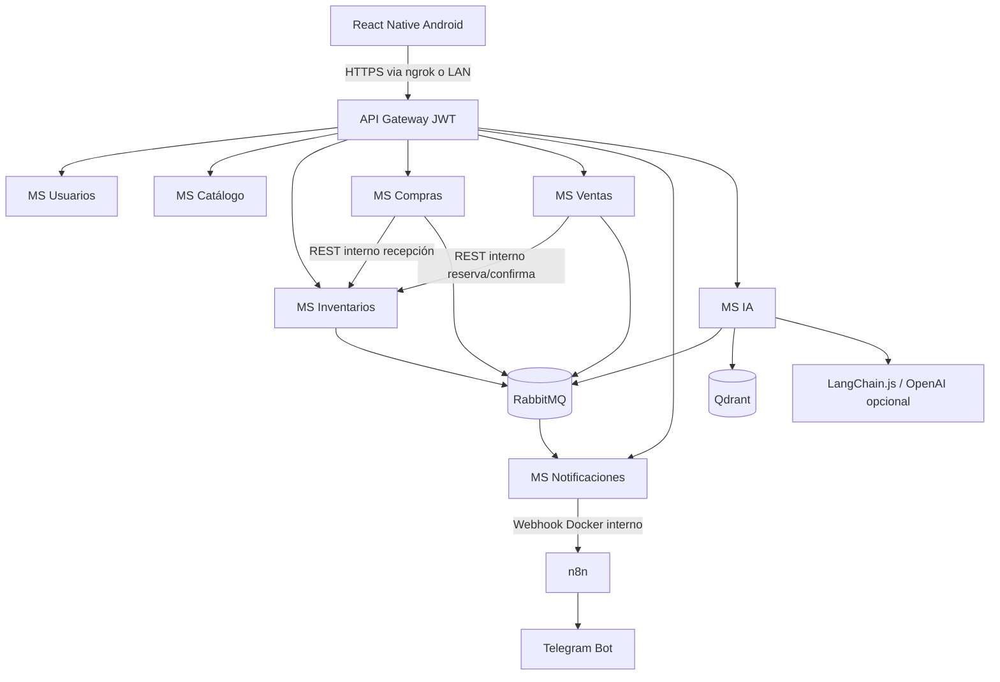

# Arquitectura técnica — FarmaStock AI

## Flujo

Las siete BD MySQL son esquemas distintos dentro de una instancia de MySQL de demostración. Cada MS tiene su usuario SQL y permisos exclusivos sobre su esquema. El frontend **no** se comunica directamente con MySQL ni RabbitMQ. Los tokens JWT se emiten desde auth-service y se verifican en Gateway; los endpoints internos requieren `x-internal-key` además de no tener puertos publicados.

## Hexagonal

- **Dominio**: entidades/reglas, independiente del framework.
- **Aplicación**: casos de uso (por ejemplo `ReserveStock.js`, `CreateSale.js`, `ScanExpiryRisk.js`).
- **Adaptadores entrada**: HTTP, consumidores RabbitMQ.
- **Adaptadores salida**: repositorios MySQL, publicar eventos, Qdrant y LangChain.
- **Infraestructura**: arranque Express, conexiones, Compose.

Las dependencias reales apuntan hacia los casos de uso y no al contrario. La capa compartida encapsula infraestructura común (`pool`, `publish`, validadores básicos, etc.). Puede refactorizarse a módulos hexagonales más estrictos en siguientes iteraciones.

## Eventos

- `inventory.stock.low` cuando la existencia disponible cae al mínimo del producto.
- `inventory.batch.received` al recibir un lote.
- `inventory.stock.changed` al confirmar una reserva.
- `sale.completed` después de confirmar una venta.
- `purchase.created` / `purchase.received` al tramitar las compras.
- `inventory.expiry.risk` después del escaneo heurístico.
- `prediction.generated` al concluir análisis.

El consumidor de `notification-service` persiste alertas en `db_notificaciones` con deduplicación por `event_id` o `dedupe_key` cuando se proporciona. Luego intenta entregarlas a n8n vía webhook (si está configurado). El bot manda el mensaje sin necesidad de publicar un webhook en Internet.

## Persistencia y consistencia

Para una venta el `sales-service` obtiene precios del catálogo y gestiona una reserva idempotente por referencia; inventarios selecciona lotes en orden de vencimiento con `SELECT ... FOR UPDATE`. La confirmación reduce el stock y registra movimientos. Este patrón es un **saga simplificada**; no ofrece atomicidad distribuida absoluta entre ventas e inventario. El código contiene caminos de reintento para operaciones parciales; en un sistema de producción se añadiría una tabla de reconciliación y el patrón outbox.

## Comunicación de la APK

- LAN: `http://IP_LAPTOP:3000` (Android HTTP habilitado solo en esta compilación de demo).
- Remoto: `https://DOMINIO_NGROK`, el túnel expone solo el Gateway.

## Observabilidad

`docker compose logs -f <servicio>` muestra logs. RabbitMQ UI: localhost:15672, n8n UI: localhost:5678, Qdrant: localhost:6333. No se exponen dashboards de administración por ngrok.
